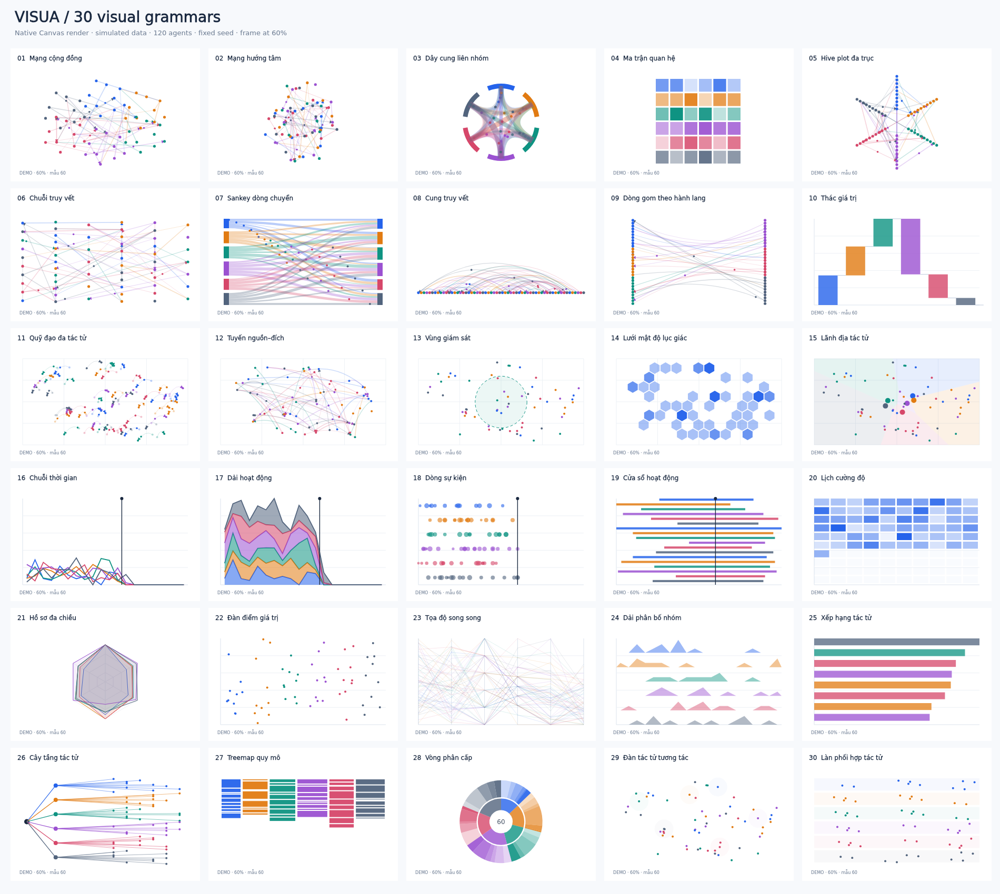

# VISUA — Investigation Visualization Studio

Dashboard nền trắng tối giản cho trực quan hóa chuỗi, tuyến, điểm, vùng, thời gian và tác tử. **300 cấu hình trực quan = 30 kiểu biểu diễn × 10 kịch bản**, mô phỏng tối đa **1.250 tác tử**. Đây là 300 preset có nội dung/ngữ cảnh khác nhau, không phải 300 thuật toán dựng hình độc lập.

Nâng cấp từ file ChainTrace Pro 100 mô hình do người dùng cung cấp. Bản gốc giữ nguyên tại [`legacy/chaintrace-100-original.html`](legacy/chaintrace-100-original.html). Phiên bản mới viết lại bộ dựng Canvas để xuất HTML độc lập và hoạt động offline; không phụ thuộc ECharts/CDN.

## Bắt đầu

1. Tải repository dưới dạng ZIP, giải nén rồi mở **`index.html`** trong Chrome, Edge hoặc Firefox hiện đại.
2. Chọn mô hình từ thư viện; tìm tên/ID, lọc kiểu biểu diễn hoặc kịch bản, lưu bằng ☆.
3. Phát/dừng, tua thời gian 0–100%, đổi tốc độ 0.5×–4×. Mô phỏng lặp lại từ 0 khi kết thúc.
4. Bấm điểm, ô hoặc dải để ghim chi tiết. Nhập ID/tên để chọn tác tử. Kéo để di chuyển, +/− để phóng/thu.
5. Bấm **Xuất HTML** để tải mô hình độc lập hoặc sao chép iframe `srcdoc`.

Trên bàn phím, khi focus vào canvas: Space = phát/dừng; ←/→ = tua 1%; +/− = zoom; Esc = bỏ chọn. Canvas thumbnail hỗ trợ Enter/Space để mở. Thiết lập giảm chuyển động của hệ điều hành sẽ dừng tự phát khi mở trang.

## Xuất & nhúng

File xuất chứa **renderer + dữ liệu + cấu hình + thời gian hiện tại**, gồm điều khiển phát, tua, tốc độ, zoom, lọc nhóm, tìm tác tử và chi tiết tương tác. Không cần backend hoặc kết nối Internet. Nếu đã nhập dữ liệu riêng, file HTML xuất cũng chứa dữ liệu đó.

Ví dụ chạy ngay: [`examples/trace-chain.html`](examples/trace-chain.html).

```html
<iframe
  src="trace-chain.html"
  title="Chuỗi truy vết động"
  sandbox="allow-scripts"
  style="width:100%;height:780px;border:0;border-radius:12px"
></iframe>
```

Hoặc sao chép trực tiếp tab **Iframe srcdoc** trong cửa sổ xuất mã. Mã `srcdoc` có thể dài khi dữ liệu lớn; dùng file HTML riêng nếu CMS giới hạn chiều dài nội dung. Clipboard có phương án chọn mã/Ctrl+C khi mở qua `file://` hoặc trình duyệt chặn clipboard.

## Các kiểu biểu diễn

| Nhóm | Kiểu biểu diễn | Preset |
|---|---|---:|
| Mạng & quan hệ | Cộng đồng, hướng tâm, dây cung, ma trận, hive | 50 |
| Chuỗi & dòng chuyển | Chuỗi tầng, Sankey, cung, hành lang, waterfall | 50 |
| Điểm · tuyến · vùng | Quỹ đạo, OD, geofence, hexbin, Voronoi | 50 |
| Thời gian & sự kiện | Time series, stream, event, Gantt, lịch cường độ | 50 |
| So sánh & phân bố | Radar, swarm, parallel, ridgeline, xếp hạng | 50 |
| Cấu trúc & tác tử | Cây phân loại, treemap, sunburst, đàn, làn | 50 |

10 kịch bản: dòng giá trị, đa chuỗi, chuỗi cung ứng, đội xe, liên lạc, nguồn gốc chứng cứ, sự cố, thực địa, hành vi tác tử, luồng truy cập. Chúng đổi vai trò, ngữ cảnh và seed dữ liệu; không tự tạo chứng cứ hoặc kết luận về con người.



## Nhập dữ liệu JSON

Chọn **Nhập JSON**, hoặc dùng [`examples/dataset.json`](examples/dataset.json) / nút **↓ JSON** làm mẫu. Kiểm tra đầu vào hoàn tất trước khi thay dữ liệu đang xem; import lỗi không làm mất dữ liệu hiện tại.

```json
{
  "version": 1,
  "synthetic": false,
  "source": "Hồ sơ đã đối soát",
  "unit": "đơn vị giá trị",
  "coordinateSystem": "schematic-2d",
  "nodes": [
    {"id": "A", "label": "Điểm nguồn", "group": 0, "stage": 0,
     "value": 100, "score": 25, "x": 20, "y": 50, "start": 0, "end": 100},
    {"id": "B", "label": "Điểm nhận", "group": 1, "stage": 1,
     "value": 80, "score": 40, "x": 80, "y": 50, "start": 10, "end": 100}
  ],
  "edges": [
    {"id": "E1", "source": "A", "target": "B", "value": 20, "time": 10, "end": 60}
  ]
}
```

| Trường | Quy tắc |
|---|---|
| `nodes` | 1–1.250 tác tử; `id` duy nhất, tối đa 100 ký tự |
| `edges` | 0–10.000 liên kết; đầu nguồn/đích phải tồn tại; ID duy nhất |
| `group`, `stage` | Số nguyên 0–5 |
| `x`, `y` | Số hữu hạn 0–100 trong mặt phẳng sơ đồ |
| `value` | Không âm, tối đa 10¹²; dùng cùng `unit` |
| `score` | Chỉ số đầu vào 0–100, **không mặc định là rủi ro** |
| `start`, `end`, `time` | Tiến độ 0–100%; end không trước start/time |
| `synthetic` | Chỉ `true` mới bật chuyển động quỹ đạo tổng hợp |
| Kích thước file | Tối đa 8 MB trong giao diện |

Đầu vào `EPSG:4326` hoặc CRS khác bị từ chối. Muốn dùng dữ liệu GIS thật, hãy chiếu/chuẩn hóa về mặt phẳng sơ đồ trước; ứng dụng không tính khoảng cách hay diện tích địa lý. Chuyển động của dữ liệu thật không được tự bịa từ một cặp x/y: quỹ đạo và đàn giữ tọa độ đầu vào khi `synthetic=false`.

## Đọc đúng kết quả

- Liên kết xuất hiện khi `time <= tiến độ`; các tổng vào/ra, xếp hạng và ma trận cộng **liên kết đã xuất hiện**. Hạt chạy trong cửa sổ `time–end`.
- Tác tử mờ khi ngoài cửa sổ `start–end`. Hexbin và ridgeline đếm **tác tử đang hoạt động**. Gantt hiển thị cửa sổ hoạt động, không mặc định là lịch làm việc thực.
- Sáu màu G1–G6 nhất quán, đi kèm nhãn; không dùng màu đỏ/xanh để khẳng định có tội/vô tội.
- Sankey tổng hợp nguồn → đích, độ dày theo `value`; dữ liệu không mặc định bảo toàn dòng. Chord/ma trận tổng hợp nhóm, tree là cây phân loại, không suy ra quan hệ sở hữu.
- Thanh thời gian là **tiến độ mô phỏng %**, không phải timestamp lịch. Lịch cường độ có 100 ô, mỗi ô bằng 1% thời lượng.
- Geofence/Voronoi/hexbin là sơ đồ 2D. Lưới lục giác không phải H3; vùng gần tâm không phải địa giới. Không suy ra vị trí địa lý từ ví blockchain.
- Lọc nhóm thay đổi khung hình; thống kê ở bảng chi tiết dashboard vẫn tính toàn bộ dữ liệu. Các aggregate thể hiện đơn vị ở chú giải hoặc tooltip.

## Hiệu năng & giới hạn

Chỉ 12 thumbnail trên mỗi trang; chỉ thumbnail trong vùng nhìn được cập nhật. Thumbnail vẽ mẫu tối đa 60 tác tử; chú thích ghi rõ mẫu. Mô hình chính tối đa 25 FPS; thumbnail khoảng 3 FPS; tab ẩn ngừng cập nhật. Có thể nhập 1.250 tác tử / 10.000 liên kết, nhưng đây là giới hạn phần mềm, không phải cam kết FPS trên mọi thiết bị.

Mô hình mạng vẽ tối đa 1.800 liên kết (OD: 1.000); số lượng vẽ/tổng được ghi ở khung hình mạng. Chọn một tác tử để tập trung các liên kết trực tiếp. Biểu đồ sự kiện lấy 350 điểm đầu, Gantt tối đa 30 dòng, xếp hạng top 14. Aggregate vẫn tính trên toàn bộ dữ liệu đến mốc đang xem. Các giới hạn này giúp tránh mạng quá rối; chưa thay cho hệ thống xử lý hàng triệu đối tượng.

Dữ liệu chỉ nằm trong phiên trình duyệt và file người dùng xuất; yêu thích được lưu cục bộ khi trình duyệt cho phép. Không có đồng bộ, thu thập dữ liệu trực tuyến, blockchain API, basemap, xác minh chứng cứ hoặc phân quyền máy chủ.

## Kiểm tra

Không cần `npm install`, không có dependency runtime/test. Node.js 20+:

```sh
npm run check
npm test
```

9 bài kiểm tra: catalogue; seed và invariant; dữ liệu lỗi; tổng theo thời gian; render toàn bộ 300 preset tại 4 mốc + thumbnail + 1.250 tác tử; chọn/zoom/kéo; HTML độc lập và escaping; DOM/asset contract; chạy widget xuất và điều khiển tương tác. CI chạy Node 22 trên Linux/Windows, các action được pin commit kiểm tra ngày 10/10/2026.

Kiểm tra trong phiên phát triển: 9/9 bài pass; dựng thật bằng Canvas native cho cả 30 kiểu và kiểm tra hai mốc 20%/60% tạo ảnh khác nhau. **Chưa kiểm tra dashboard trong trình duyệt thật** do công cụ preview trình duyệt không khả dụng trong môi trường phát triển. Ảnh trên là các renderer Canvas, không phải ảnh chụp dashboard.

## GitHub Pages

Repository dùng HTML/CSS/JS tĩnh, đã có `.nojekyll`. Để bật hosting: **Settings → Pages → Deploy from a branch → main / (root)**. Sau khi GitHub báo deployment thành công, địa chỉ dự kiến là `https://base27-cvnss.github.io/visua/`. Source commit không tự chứng minh hosting đã bật.

## Cấu trúc

```text
index.html                    Dashboard
assets/styles.css             Thiết kế responsive nền trắng
assets/catalogue.js           30 kiểu × 10 kịch bản
assets/data.js                Seed, validate, thống kê
assets/engine.js              Canvas renderer và hit testing
assets/export.js              HTML độc lập và iframe srcdoc
assets/app.js                 Điều khiển dashboard
examples/                     HTML xuất và JSON mẫu
legacy/                       File gốc 100 mô hình (cần CDN)
tests/                        Node tests không dependency
```

Hoàn tác bản phát hành bằng Git revert commit nguồn; dữ liệu nhập và file HTML đã xuất không bị thay đổi khi hoàn tác source.
